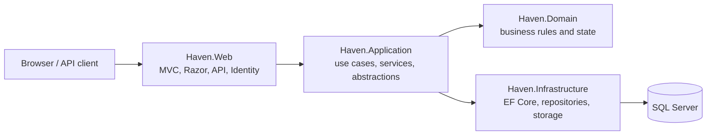

# HAVEN

HAVEN là nền tảng web để khám phá, đăng và quản lý tin bất động sản. Người tìm nhà có thể lọc và so sánh tin công khai; chủ tin quản lý nội dung và gửi duyệt; quản trị viên kiểm duyệt tin và vận hành danh mục, tài khoản cùng các yêu cầu hỗ trợ.

Ứng dụng hiện được xây dựng bằng ASP.NET Core MVC và Razor Views. Đây là một ứng dụng web phân lớp trong một solution .NET, không phải SPA hay hệ thống microservices.

## Tính năng

- **Khách:** khám phá trang chủ, tìm kiếm và lọc tin, xem chi tiết, so sánh tối đa ba tin, xem hồ sơ công khai của người đăng và gửi yêu cầu tư vấn sau khi đăng nhập.
- **Tài khoản:** đăng ký, đăng nhập, đăng xuất, đổi mật khẩu, cập nhật hồ sơ và avatar. Avatar nhận JPEG, PNG hoặc WebP, tối đa 5 MiB.
- **Chủ tin:** tạo và chỉnh sửa tin, quản lý ảnh và video, gửi tin để kiểm duyệt và theo dõi trạng thái. Chủ tin chỉ thao tác trên nội dung của tài khoản mình.
- **Hồ sơ công khai:** `/members/{id}` hiển thị tên, avatar và các tin đã duyệt của người dùng theo trang; không hiển thị email hoặc dữ liệu Identity riêng tư.
- **Quản trị viên:** dashboard và báo cáo, quản lý người dùng và trạng thái khóa, kiểm duyệt tin, quản lý loại bất động sản và nhãn, xử lý yêu cầu tư vấn và yêu cầu quyền riêng tư.

Tin chưa được duyệt không xuất hiện trong kết quả tìm kiếm công khai. Các endpoint API, model request/response và quyền truy cập được mô tả trong [API Contract](docs/frontend/API_CONTRACT.md); giao diện MVC có thêm các luồng riêng không thuộc hợp đồng API.

## Công nghệ và kiến trúc

- .NET SDK `10.0.401` theo `global.json`; các project nhắm tới `net10.0`.
- ASP.NET Core MVC, Razor Views, ASP.NET Core Identity và cookie authentication.
- Entity Framework Core 10 với SQL Server.
- Bootstrap 5.3.3, JavaScript và jQuery Validation được cung cấp từ assets trong Web project.
- OpenAPI và Scalar chỉ được bật trong môi trường Development.
- xUnit cho unit và integration tests; integration tests dùng EF Core InMemory.
- GitHub Actions restore, build Release và chạy tests cho `main` và `develop`.



### Cấu trúc repository

```text
HAVEN/
├── src/
│   ├── Haven.Web/                 # Web entry point, controllers, views, static assets
│   ├── Haven.Application/         # Use cases, application services and abstractions
│   ├── Haven.Domain/              # Domain entities and business rules
│   └── Haven.Infrastructure/      # EF Core, Identity persistence, repositories, storage
├── tests/
│   ├── Haven.UnitTests/
│   └── Haven.IntegrationTests/
├── docs/                          # Architecture, workflow, API and QA documentation
├── compose.yaml                   # Local SQL Server container
├── global.json                    # .NET SDK selection
└── HAVEN.slnx
```

## Bắt đầu

### Yêu cầu

- Git và .NET SDK `10.0.401` (hoặc SDK phù hợp với `rollForward: latestFeature` trong `global.json`).
- Một SQL Server local: SQL Server Express trên Windows hoặc Docker Engine/Desktop kèm Docker Compose v2.
- PowerShell cho các ví dụ bên dưới. Visual Studio/VS Code và SQL Server Management Studio là tùy chọn.
- Node.js không cần thiết để restore, build hoặc chạy ứng dụng.

### Clone và restore

```powershell
git clone https://github.com/xduc199/HAVEN.git
Set-Location HAVEN
git switch develop
dotnet restore HAVEN.slnx
```

Các lệnh tiếp theo chạy từ thư mục gốc của repository.

### Cấu hình SQL Server

Ứng dụng đọc connection string từ `ConnectionStrings:HavenDb`. Hai launch profile `http` và `https` chạy với `ASPNETCORE_ENVIRONMENT=Development`. Không đặt mật khẩu hoặc connection string có thông tin xác thực trong file được commit.

Chọn một trong hai cách cấu hình:

#### SQL Server Express

`appsettings.Development.json` có mặc định local cho instance `SQLEXPRESS` dùng Windows Authentication. Nếu cần đặt lại bằng User Secrets:

```powershell
dotnet user-secrets set "ConnectionStrings:HavenDb" 'Server=.\SQLEXPRESS;Database=HavenDb;Trusted_Connection=True;Encrypt=True;TrustServerCertificate=True' --project src\Haven.Web\Haven.Web.csproj
```

SQL Server Express phải đang chạy và tài khoản Windows chạy Web/EF phải có quyền kết nối.

#### SQL Server bằng Docker Compose

Tạo `.env` local từ mẫu và đặt mật khẩu SA mạnh, riêng cho máy đang phát triển:

```powershell
Copy-Item .env.example .env
notepad .env
docker compose up -d haven-db
docker compose logs --tail 50 haven-db
```

Đợi log xác nhận SQL Server sẵn sàng. Compose mở cổng `127.0.0.1:1433` và lưu dữ liệu trong volume `haven_sql_data`. `.env` chỉ được Docker Compose đọc; Web project không đọc file này. Đưa connection string của ứng dụng vào User Secrets:

```powershell
dotnet user-secrets set "ConnectionStrings:HavenDb" 'Server=127.0.0.1,1433;Database=HavenDb;User ID=sa;Password=<MAT_KHAU_LOCAL>;Encrypt=True;TrustServerCertificate=True' --project src\Haven.Web\Haven.Web.csproj
```

Thay placeholder bằng mật khẩu bạn vừa đặt trong `.env`; không đưa giá trị đã điền vào Git, log hoặc tin nhắn. `docker compose stop haven-db` và `docker compose start haven-db` giữ dữ liệu. `docker compose down -v` xóa volume và database local.

Thay vì User Secrets, có thể đặt biến môi trường trong cửa sổ PowerShell hiện tại:

```powershell
$env:ConnectionStrings__HavenDb = 'Server=127.0.0.1,1433;Database=HavenDb;User ID=sa;Password=<MAT_KHAU_LOCAL>;Encrypt=True;TrustServerCertificate=True'
```

Trong Development, User Secrets và environment variables có ưu tiên cao hơn giá trị trong `appsettings.Development.json`.

### Cập nhật database

DbContext là `ApplicationDbContext` trong `Haven.Infrastructure`; migrations cũng nằm trong project này. Web là startup project. Ứng dụng không tự áp dụng migrations khi khởi động. Cài `dotnet-ef` phiên bản phù hợp một lần nếu chưa có:

```powershell
dotnet tool install --global dotnet-ef --version 10.0.13
```

Xác nhận connection string đang trỏ tới đúng database local trước khi chạy lệnh cập nhật. Từ thư mục gốc:

```powershell
dotnet ef migrations list --project src\Haven.Infrastructure\Haven.Infrastructure.csproj --startup-project src\Haven.Web\Haven.Web.csproj --context ApplicationDbContext
dotnet ef database update --project src\Haven.Infrastructure\Haven.Infrastructure.csproj --startup-project src\Haven.Web\Haven.Web.csproj --context ApplicationDbContext
```

Migration mới nhất hiện có là `20261119170000_AddUserAvatar`, bổ sung cột nullable `AvatarPath` vào `AspNetUsers`. Áp dụng migration lên database local đã chọn trước khi chạy Web. Không xóa database để xử lý schema mismatch và không áp dụng hướng dẫn này vào production.

Khi khởi động, ứng dụng có thể nạp danh mục địa giới vào database rỗng. Seeder không áp dụng migrations và không ghi đè dữ liệu địa giới hiện có. Tài khoản Admin chỉ được bootstrap khi cấu hình cả `Haven:AdminBootstrap:Email` và `Haven:AdminBootstrap:Password`; đặt các giá trị này bằng User Secrets hoặc cấu hình môi trường cục bộ, không commit chúng.

### Chạy ứng dụng

```powershell
dotnet run --project src\Haven.Web\Haven.Web.csproj --launch-profile https
```

Profile `https` dùng Development và mở `https://localhost:7081` cùng `http://localhost:5104`; profile `http` chỉ dùng `http://localhost:5104`. Nếu chứng chỉ HTTPS Development chưa được tin cậy, chạy `dotnet dev-certs https --trust` trên máy local.

Trong Development, tài liệu OpenAPI được phục vụ bởi ứng dụng và giao diện Scalar có thể được mở tại `/scalar/v1`. Các endpoint này không được bật ngoài Development.

## Kiểm thử

```powershell
dotnet build HAVEN.slnx --configuration Release --no-restore
dotnet test HAVEN.slnx --configuration Release --no-build
```

Chạy riêng từng nhóm:

```powershell
dotnet test tests\Haven.UnitTests\Haven.UnitTests.csproj
dotnet test tests\Haven.IntegrationTests\Haven.IntegrationTests.csproj
```

Unit tests tập trung vào quy tắc Domain và Application. Integration tests dùng `WebApplicationFactory` cùng EF Core InMemory để kiểm tra luồng Web/API; chúng không xác minh connection string, migrations hoặc hành vi riêng của SQL Server. CI hiện restore solution, build Release và test Release.

## Cấu hình và lưu trữ

- Connection string: `ConnectionStrings:HavenDb`.
- Tạo Admin ban đầu (tùy chọn): `Haven:AdminBootstrap:Email` và `Haven:AdminBootstrap:Password`.
- Listing images/videos: mặc định lưu local ngoài webroot dưới `src/Haven.Web/App_Data/ListingImages`; có thể đổi bằng `Haven:Media:StoragePath`. Môi trường nhiều instance cần một vùng lưu trữ bền vững dùng chung hoặc cơ chế đồng bộ phù hợp.
- Avatar: ảnh được xác thực theo định dạng và nội dung, tên file do server tạo; chấp nhận JPEG/PNG/WebP với giới hạn 5 MiB.

## Tài liệu

- [Architecture](docs/ARCHITECTURE.md) — các layer và cấu trúc solution.
- [API Contract](docs/frontend/API_CONTRACT.md) — endpoint API, request/response và quyền truy cập.
- [Frontend Architecture](docs/frontend/FRONTEND_ARCHITECTURE.md) — tổ chức MVC/Razor và tích hợp giao diện.
- [Workflow](docs/WORKFLOW.md) — các bước từ nhận nhiệm vụ đến Pull Request.
- [Contributing](CONTRIBUTING.md) — nhánh, commit, review và checklist đóng góp.
- [QA reports](docs/qa/) — báo cáo kiểm thử theo từng đợt.
- [Kế hoạch phân công nhóm](docs/HAVEN_phan_cong_5_thanh_vien/README_HUONG_DAN_CHUNG.md) — tài liệu kế hoạch, không phải nguồn mô tả trạng thái tính năng.

## Quy trình đóng góp

`develop` là nhánh tích hợp và `main` là nhánh ổn định. Tạo nhánh công việc từ `develop`, chạy build/test phù hợp, rồi mở Pull Request về `develop`; thay đổi phát hành được đề xuất từ `develop` sang `main`. Xem [CONTRIBUTING.md](CONTRIBUTING.md) và [docs/WORKFLOW.md](docs/WORKFLOW.md) trước khi bắt đầu.

## Giới hạn hiện tại

- Chưa tích hợp email sender; đăng ký không yêu cầu xác nhận email.
- Media được lưu trữ local, nên triển khai cần cấu hình vùng lưu trữ bền vững phù hợp với số lượng instance.
- API tests dùng InMemory provider; vẫn cần kiểm tra migrations và SQL Server trên database phát triển được chỉ định.
- Repository chưa khai báo giấy phép mã nguồn mở; không mặc định rằng code được cấp phép để phân phối lại.
